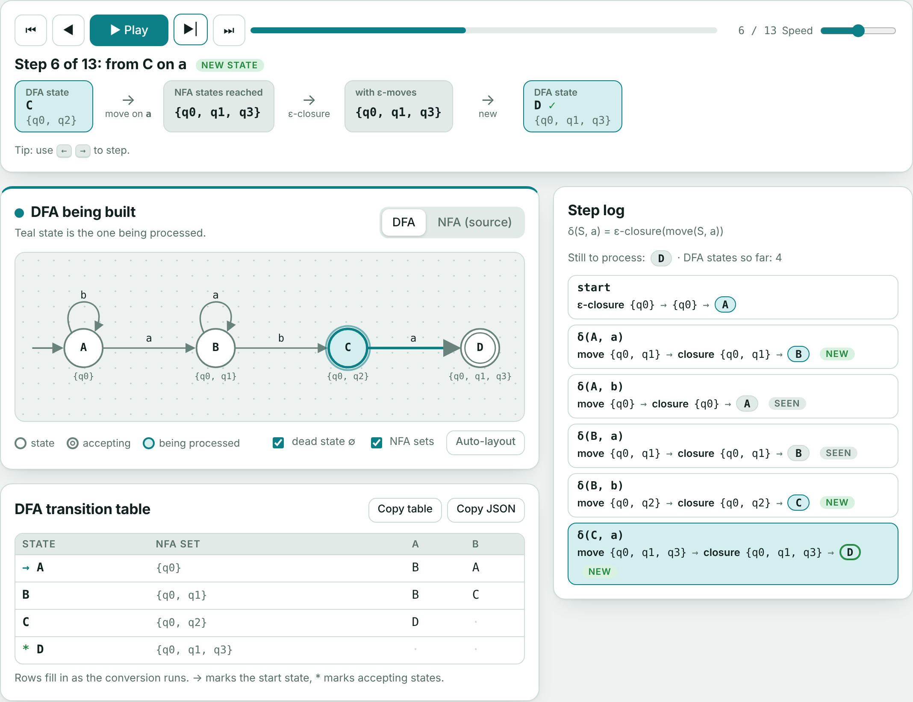

# NFA to DFA Simulator



**CSET302 Automata Theory and Computability** · School of Computer Science Engineering and Technology (SCSET), Bennett University

## Team

| Name | Roll no. |
|---|---|
| Harsh Khandelwal | S24CSEU1988 |
| Kshitij Saxena | S24CSEU0050 |
| Anuj Gupta | S24CSEU1990 |
| Ayush Rautela | S24CSEU1986 |
| Pratyaksh Manav | S24CSEU1976 |

**Submitted to:** Ma'am Rashmi Kumari

## About

A browser-based tool that converts an ε-NFA to a DFA with the **subset construction**, shows every step, minimises the DFA, and tests strings on all three machines.

No installation is needed to use it: open `dist/nfa-dfa-simulator.html` in any modern browser.

## Features

- **Define NFA:** edit states, symbols, ε-moves, start and accepting states in a table. Every edit is validated. Load examples, or import and export JSON.
- **Convert:** play or step through the subset construction (arrow keys work), with an explanation, a step log, a worklist and the DFA transition table.
- **Compare:** NFA, DFA and minimal DFA side by side, with a table mapping DFA states to NFA states and minimal states.
- **Test strings:** run a string on all three machines and watch the active states symbol by symbol.
- Draggable diagrams, light and dark theme, phone-friendly layout.

## Run it

```bash
npm start          # dev server at http://localhost:8080
npm run build      # bundles everything into dist/nfa-dfa-simulator.html
```

On Windows, double-click **`start.bat`** to open the simulator at once, or **`run.bat`** for a menu: open the simulator, start the dev server, rebuild, run tests or install test dependencies.

You can also open `index.html` directly in a browser. Fonts load from Google Fonts and fall back to system fonts when offline.

## Project structure

```
start.bat                Windows: open the simulator
run.bat                  Windows menu (open, serve, build, test)
index.html               page markup (four screens)
src/css/styles.css       styles, light and dark theme tokens
src/js/utils.js          constants and DOM helpers
src/js/presets.js        built-in example automata
src/js/core.js           ε-closure, move, subset construction, minimisation, running strings (no DOM)
src/js/graph.js          graph layout, SVG drawing, dragging
src/js/app.js            state, the four screens, editor, import/export, start-up
scripts/serve.js         local static server
scripts/build.js         single-file bundler
tests/unit/              unit tests for the core (Node test runner)
tests/e2e/               30 browser tests, T01-T30 (Playwright, Chromium)
tests/crosscheck/        random-automata checks against independent oracles and automata-lib
docs/                    project report, screenshots, basis for each expected test result
dist/                    built single-file simulator
```

## Tests

```bash
npm install                 # installs Playwright
npx playwright install chromium
npm test                    # unit tests (9)
npm run test:e2e            # 30 browser tests, writes tests/e2e/results.json
npm run test:crosscheck     # 3,000 random ε-NFAs vs an independent simulator, then automata-lib
```

The cross-check needs Python 3 and `pip install automata-lib==9.2.0`.

Results recorded for this version: 30 of 30 browser tests pass; 3,000 random ε-NFAs agree on 5,272,250 strings; 600 random automata match automata-lib in language, DFA size and minimal size.

## How it works

The subset construction returns one ordered list of steps. The log, table, diagram and explanation panel are all drawn from that list, so stepping forward or back only changes a position in the list. Each DFA state is a sorted set of NFA states; a worklist adds new sets until none are left; the empty set becomes a dead state. Minimisation uses partition refinement.

## Limits

- Symbols are single characters.
- The conversion stops at 256 DFA states (an NFA with n states can need up to 2^n).
- Tested in Chromium only.

## Team

| Name | Roll no. |
| --- | --- |
| Harsh Khandelwal | S24CSEU1988 |
| Kshitij Saxena | S24CSEU0050 |
| Anuj Gupta | S24CSEU1990 |
| Ayush Rautela | S24CSEU1986 |
| Pratyaksh Manav | S24CSEU1976 |

Faculty: Rashmi Kumari.

## License

MIT, see `LICENSE`.

## Documentation

The full project report is in `docs/Project_Report.docx`, and the basis for each expected test result is in `docs/test-basis.md`.

## License

See `LICENSE`.
